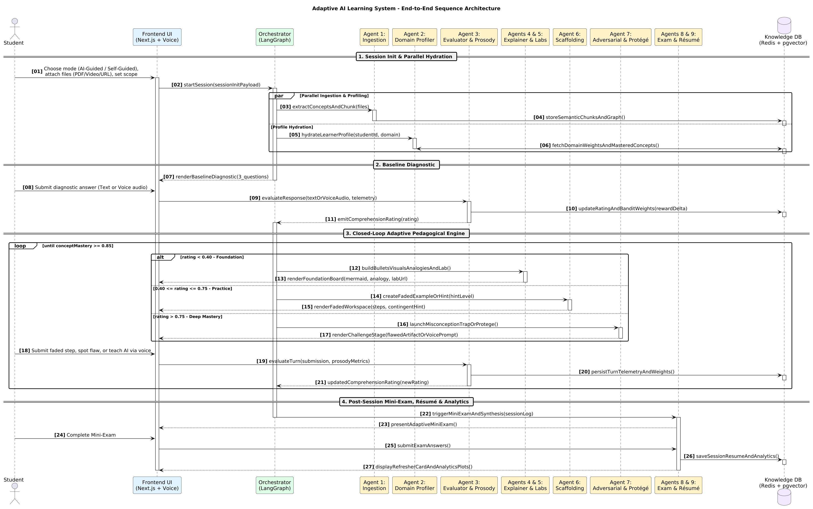

# Adaptive AI Learning Companion

An AI-powered study platform designed to replace passive reading and surface memorization with **deep, durable understanding**.

Instead of giving generic, one-size-fits-all answers, the platform diagnoses how well a student actually understands a concept—using both text and voice signals—and dynamically adapts its teaching strategy, interface, and difficulty level in real time.

---

## What Problem Does It Solve?

Most students study passively: re-reading notes, highlighting textbooks, or memorizing definitions without truly grasping *why* a concept works. Standard AI chatbots make this worse by immediately handing over complete answers.

This platform flips the learning process:
- **Never gives away the full answer prematurely.**
- **Detects hesitation and rote memorization** through voice cadence and response patterns.
- **Adapts to how you learn best in each subject** (e.g., visual diagrams for Literature vs. faded coding problems for Computer Science).

---

## Key Features

### 1. Dual Learning Modes
- **AI-Guided Mode:** Upload any study resource (PDFs, lecture videos, slides, or links), take a quick 3-question diagnostic, and let the AI orchestrate a personalized step-by-step mastery path.
- **Self-Guided Mode:** Explore your documents, summaries, and interactive sandboxes at your own pace, summoning AI explanations, hints, or quizzes whenever you get stuck.

### 2. Three Adaptive Mastery Tiers
As your live **Comprehension Rating (`0% – 100%`)** evolves during a session, the workspace automatically transforms:
- **Foundation (`< 40%`):** Breaks topics into crisp bullet points, generates visual diagrams (Mermaid.js), builds analogies from concepts you already mastered in past sessions, and embeds live **Interactive Labs** (PhET, Desmos, CodeSandbox).
- **Guided Practice (`40% – 75%`):** Uses **Faded Worked Examples** (showing the first steps and letting you complete the rest) paired with a 3-level **Contingent Hint Ladder** that nudges you without spoiling the solution.
- **Deep Mastery (`> 75%`):** Challenges you with **Hidden Misconception Traps** (*"Spot the subtle flaw in this explanation"*) and **Protégé Mode** (*"Teach the concept to the AI while it asks tough follow-up questions"*).

### 3. Voice Recognition & Fluency Intelligence
Students can answer questions and teach concepts out loud. Beyond transcribing words, the system analyzes **speech pace, pauses, and filler words** to distinguish confident, causal understanding from memorized recitation—offering gentle study-habit coaching when needed.

### 4. Cross-Session & Subject-Specific Memory
- **Domain-Aware Adaptation:** Tracks which teaching methods work best for you in each specific academic field and prioritizes them automatically.
- **Cross-Domain Analogies:** Remembers concepts you mastered weeks ago across *any* subject and uses them as mental bridges to explain brand-new topics.

### 5. Post-Session Résumés, Mini-Exams & Analytics
- **Adaptive Mini-Exams:** Generates targeted end-of-session tests built around the exact misconceptions you struggled with earlier.
- **Refresher Résumé Cards:** Automatically summarizes every completed session into a scannable cheat sheet (*Core Mental Model*, *Winning Analogies*, and *Misconceptions Conquered*) for future review.
- **Learning Analytics Dashboard:** Visualizes your **Mastery per Field**, **Best Learning Styles**, **Mastery Speed Over Time**, and **Lessons Learned**.

### 6. Mathematical & Decision Model

The orchestrator, prosody analyzer, personalization engine, and analytics dashboard are governed by the following formal variables and update rules:

| Subsystem | Variable / Metric | Mathematical Formulation | Operational Rule & Thresholds |
| :--- | :--- | :--- | :--- |
| **Pedagogical State** | **Comprehension Rating ($R_t$)** | $R_t = \text{clip}\big(w_A A_t + w_D D_t - 0.03 L_{\text{hint}},\ 0,\ R_{\max}\big)$ | Weighted blend of factual accuracy ($A_t$), causal depth ($D_t$), and hint level ($L_{\text{hint}} \in \{0..3\}$). Routes tier: $< 0.40$ (Foundation), $0.40\text{–}0.75$ (Scaffolding), $> 0.75$ (Mastery), $\ge 0.85$ (Mastered). Capped at $R_{\max} = 0.78$ when $M_{\text{rote}} = 1$. |
| **Remediation Gate** | **Mistake Flag ($I_{\text{err}}$)** | $I_{\text{err}} = \mathbb{I}(A_t < 0.70 \lor D_t < 0.65 \lor M_{\text{rote}} = 1)$ | When $I_{\text{err}} = 1$, blocks advancement, generates a targeted Counter-Example, escalates $L_{\text{hint}} \to \min(L_{\text{hint}} + 1,\ 3)$, and increments consecutive mistakes ($k_{\text{err}}$). |
| **Concept DAG** | **Prerequisite Unlock & Backtrack** | $\text{Unlock}(c) \iff \forall p \in \mathcal{P}(c),\ R_p \ge 0.75$ | Unlocks node $c$ once all parent prerequisites $\mathcal{P}(c)$ reach $0.75$. If $k_{\text{err}} \ge 3$ (or $\text{attempts} \ge 2 \land R_c < 0.40$), backtracks active node to $\arg\min_{p \in \mathcal{P}(c)} R_p$. |
| **Voice Prosody** | **Speech Rate ($\text{WPM}$)** | $\text{WPM} = \frac{N_{\text{words}}}{T_{\text{speech (sec)}}} \times 60$ | Extracted from local `faster-whisper` word timestamps; rates $> 170\text{ WPM}$ contribute to surface-memorization detection. |
| **Voice Prosody** | **Hesitation Pauses ($P_{\text{hes}}$)** | $P_{\text{hes}} = \sum_{i=1}^{N-1} \mathbb{I}(t_{\text{start}, i} - t_{\text{end}, i-1} > 1.5\text{s})$ | Counts mid-explanation cognitive stalls exceeding $1.5\text{s}$; $P_{\text{hes}} \ge 2$ triggers a supportive Contingent Hint. |
| **Voice Prosody** | **Filler-Word Ratio ($\rho_{\text{fill}}$)** | $\rho_{\text{fill}} = \frac{N_{\text{fillers}}}{\max(N_{\text{words}}, 1)}$ | Ratio of verbal fillers (*"um"*, *"uh"*, *"like"*, *"basically"*) to total words; $\rho_{\text{fill}} > 0.12$ signals verbal uncertainty. |
| **Voice Prosody** | **Rote Recitation Flag ($M_{\text{rote}}$)** | $M_{\text{rote}} = \mathbb{I}(N_{\text{words}} \ge 15 \land \text{WPM} > 170 \land P_{\text{hes}} = 0 \land C_{\text{corr}} = 0)$ | Detects rapid, unpaused verbatim recitation ($C_{\text{corr}}$ = self-corrections), capping mastery below $0.85$ and triggering a Misconception Trap. |
| **Personalization** | **Domain Strategy Weight ($W_{d,m}$)** | $W_{d,m}^{(t)} = \text{clip}\big(W_{d,m}^{(t-1)} + \alpha (R_t - R_{t-1}),\ 0.10,\ 1.00\big)$ | Multi-Armed Bandit reinforcement ($\alpha = 0.25$) updating the weight of teaching technique $m$ within academic domain $d$. |
| **Memory & Labs** | **Semantic Similarity ($S_{\cos}$)** | $S_{\cos}(\mathbf{u}, \mathbf{v}) = \frac{\mathbf{u} \cdot \mathbf{v}}{\lVert \mathbf{u} \rVert \lVert \mathbf{v} \rVert}$ | Cosine similarity over 384-d `bge-small-en-v1.5` embeddings; matches interactive labs at $> 0.62$ and pre-credits prior mastered concepts at $> 0.88$. |
| **Retention** | **Spaced Review Interval ($\Delta t_{\text{rev}}$)** | $\Delta t_{\text{rev}} = \begin{cases} 1\text{ day} & S_{\text{exam}} < 0.75 \\ 3\text{ days} & 0.75 \le S_{\text{exam}} < 0.90 \\ 7\text{ days} & S_{\text{exam}} \ge 0.90 \end{cases}$ | Schedules the next spaced-repetition refresher for each `SessionResumeArtifact` based on unassisted Mini-Exam score ($S_{\text{exam}}$). |
| **Analytics** | **Mastery per Field ($\bar{M}_d$)** | $\bar{M}_d = \frac{1}{\lvert C_d \rvert} \sum_{c \in C_d} R_c$ | Mean comprehension rating across all concepts $C_d$ in subject domain $d$ (rendered on the Domain Radar Chart). |
| **Analytics** | **Technique ROI ($\text{ROI}_{m,d}$)** | $\text{ROI}_{m,d} = \frac{1}{N_{m,d}} \sum_{k=1}^{N_{m,d}} (R_{\text{after}, k} - R_{\text{before}, k})$ | Empirical average comprehension delta per turn for methodology $m$ in domain $d$ (rendered on the Best Learning Style Chart). |
| **Analytics** | **Mastery Velocity ($V$)** | $V = \frac{R_{\text{final}} - R_{\text{initial}}}{\max(\Delta t_{\text{active (min)}}, 1)}$ | Net comprehension gained per active study minute; tracks learning speed acceleration across sessions. |
| **Analytics** | **Durable Retention Rate ($\eta_{\text{ret}}$)** | $\eta_{\text{ret}} = \frac{S_{\text{exam}}}{R_{\text{final}}}$ | Ratio of unassisted Mini-Exam accuracy to end-of-session comprehension rating; measures true retention vs. short-term recall. |

---

## High-Level Architecture

The end-to-end execution flow across the Frontend UI, LangGraph Orchestrator, specialized sub-agents, and dual memory layer (`Redis` + `PostgreSQL/pgvector`) is illustrated below:

> *Diagram source available at [`docs/architecture-sequence.puml`](docs/architecture-sequence.puml).*

---

## Roadmap

- [x] Multimodal resource ingestion & semantic concept chunking
- [x] Comprehension-driven state machine (Foundation $\rightarrow$ Scaffolding $\rightarrow$ Mastery)
- [x] Voice prosody & hesitation analysis for Protégé Mode
- [x] Domain-specific learning style weighting & cross-session analogies
- [ ] Spaced-repetition scheduling for Session Résumé refreshers
- [ ] Collaborative study rooms & peer misconception challenges
